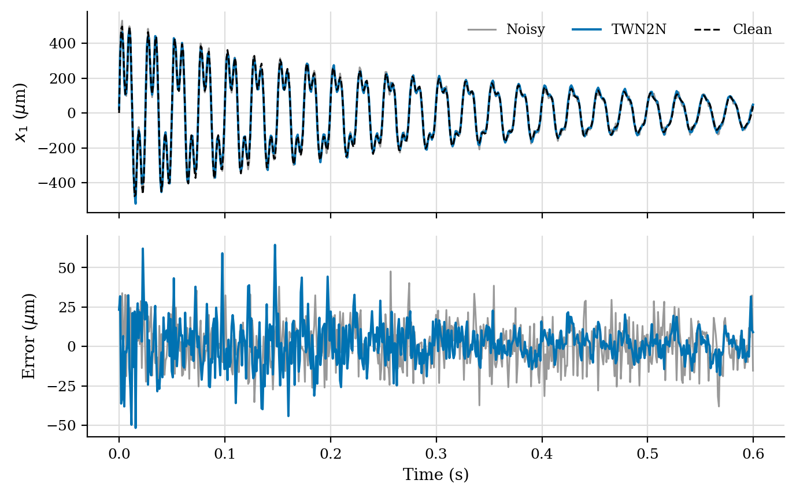

# Time-Window Noise2Noise (TWN2N)

[](https://doi.org/10.5281/zenodo.24355386)

TWN2N is a self-supervised method for the blind denoising of signals measured in dynamical systems, such as the
vibration of a structure or the force of an impact. This repository contains its Python library. The user provides
the noisy signals and chooses two parameters; the library builds the network, trains it on those same signals, and
returns the denoised signals. No clean reference signal and no description of the noise are required.

The method is described in the paper:

> V. S. Vianna, T. H. Machado, and I. F. Santos. *Time-Window Noise2Noise: Self-Supervised Blind Denoising of
> Mechanical Vibration and Impact Signals*. Preprint: [arXiv:2608.24443](https://arxiv.org/abs/2608.24443).



*Displacement of the first mass of the vibration benchmark of the paper, with white noise at an input
signal-to-noise ratio (SNR) of 15 dB. Top: noisy measurement, TWN2N output, and clean signal. Bottom: error of the
noisy measurement and of the TWN2N output.*

## How the method works

Let $X(t_i)$ be the vector with the values of all channels at the instant $t_i$. For a window size $p$, the input
of the network gathers the $p$ samples before and the $p$ samples after $t_i$:

$$\mathbf{X}_{i,p} = \left[ X(t_{i-p}), \dots, X(t_{i-1}), X(t_{i+1}), \dots, X(t_{i+p}) \right]~,$$

and the training target is the noisy sample $X(t_i)$ itself. Three elements make this training remove noise:

- **Blind spot:** the sample at $t_i$ is left out of the input, so the network cannot copy it and has to predict it
  from its neighbors. The part of the signal that follows the dynamics of the system can be predicted in this way;
  noise that is uncorrelated in time cannot.
- **Joint channels:** a single network receives and reconstructs all channels, so it can use the relations between
  them, for example between the displacements and the accelerations of a structure.
- **Bottleneck:** the prediction passes through an autoencoder whose narrowest layer has fewer units than the number
  of channels, which favors the coherent part of the signals over the noise.

Because the target is noisy, training until the loss reaches its minimum would start to reproduce the noise. The
library therefore applies the stopping rule of the paper: 10% of the windows are held out, the weights with the
lowest validation loss are kept, and the training stops when that loss has not improved for 100 epochs and exceeds
the training loss.

The first and the last $p$ samples of each record have no complete window. They are not used as training targets
and are returned as measured.

## Installation

The library requires Python 3.9 or newer.

```bash
pip install git+https://github.com/viniciuserra/Time-Window_Noise2Noise.git
```

To run the examples and the case studies of the paper, clone the repository:

```bash
git clone https://github.com/viniciuserra/Time-Window_Noise2Noise.git
cd Time-Window_Noise2Noise
pip install -e .
pip install -r requirements.txt
```

The library depends on NumPy, SciPy, scikit-learn, and TensorFlow 2.10 or newer (tested with versions 2.10 and
2.21). The networks are small (17,218 parameters in the main case study) and train in a few minutes on a central
processing unit (CPU), so a graphics processing unit (GPU) is not needed.

## Quick start

```python
import numpy as np
import twn2n

# one row per time sample, one column per channel
noisy = np.loadtxt("my_signals.csv", delimiter=",")

model = twn2n.TWN2N(p=2, r=4)
denoised = model.fit_denoise(noisy)        # same shape as `noisy`
```

The same result is obtained in one call with `twn2n.denoise(noisy, p=2, r=4)`. The signals can be given
in three forms:

- an array with shape `(n_samples, n_channels)`, or `(n_samples,)` for a single channel;
- a `pandas.DataFrame` with one column per channel, in which case a `DataFrame` is returned;
- a list of arrays, one per record, for several records of the same system (for example, repeated tests).

The records of a list may have different lengths, and the time windows never cross from one record to the next.

Signals stored in a CSV file can also be denoised from the command line, without writing code. The option
`--columns` selects the signal columns; the other columns, such as a time column, are copied unchanged:

```bash
python -m twn2n noisy.csv denoised.csv --p 2 --r 4 --columns 1,2,3,4,5,6
```

After the training, `model.epochs_run_`, `model.best_epoch_`, `model.training_time_s_`, and `model.history_`
describe it; `model.denoise(other)` applies the trained network to other records of the same system; and
`model.save("model.npz")` and `twn2n.TWN2N.load("model.npz")` store and restore it.

## The two parameters

| Parameter | Meaning | How to choose |
|---|---|---|
| `p` | Number of neighbors taken on each side of the masked sample. The network has `2 * p * n_channels` inputs. | The paper uses `p = 2` in every experiment: it is the smallest symmetric window that contains the central-difference stencil of a second-order system once the central sample is masked. |
| `r` | Number of units of the bottleneck (the latent dimension). | Smaller than the number of channels, so that the bottleneck compresses the output. The paper uses 4 for six channels and 3 for five channels. |

Neither parameter was tuned in the paper, because tuning them by the output SNR would require the clean signal.

The remaining arguments of `TWN2N` keep the training protocol of the paper by default: `network="standard"` (use
`"compact"` for the smaller architecture of the impact case study, or pass a function that builds a custom Keras
model), `epochs=5000` as the upper limit, `batch_size=32`, `learning_rate=1e-3`, `patience=100`,
`validation_fraction=0.1`, and `seed=None`. With `verbose=2`, one line per epoch is printed.

## Noise models and SNR measurement

To test a denoiser, the library adds the four noise models of the paper to clean signals and measures the SNR.

```python
noisy = twn2n.add_noise(clean, kind="white", snr_db=15.0, rng=0)    # also "pink" and "brown"
quantized = twn2n.add_noise(clean, kind="quantization", bits=12, peak_fraction=0.0035)

twn2n.snr_db(clean, noisy)                    # SNR against the clean reference, in dB
twn2n.snr_gain_db(clean, noisy, denoised)     # output SNR minus input SNR
twn2n.band_snr_db(clean, denoised, band=(0.0, 300.0), fs=1024.0)    # SNR inside a frequency band
```

The SNR follows the definition of the paper:

$$\mathrm{SNR} = 20 \log_{10} \frac{\sigma(x_0)}{\sigma(x - x_0)}~,$$

where $x_0$ is the clean signal, $x$ is the signal under evaluation, and $\sigma$ denotes the standard deviation.
The white, pink, and brown models are additive, and each channel receives an independent sequence scaled to the
requested SNR. The quantization model rounds each channel to the levels of an ideal analog-to-digital converter,
so its noise level follows from the resolution of the converter.

## Other tools

| Module or function | Content |
|---|---|
| `twn2n.filters` | Classical filters used as baselines in the paper: zero-phase Butterworth low-pass filter, Savitzky-Golay filter, and VisuShrink wavelet threshold (requires PyWavelets). |
| `twn2n.modal` | Identification of natural frequencies and damping ratios from free responses with the Ibrahim Time Domain (ITD) method. |
| `twn2n.benchmarks` | The two numerical benchmarks of the paper: the impulse responses of a mass-spring-damper system with three degrees of freedom (3-DOF) and a set of impacts that follow the contact law of Hunt and Crossley. |
| `twn2n.blind_spot_windows` | The masked time windows, for users who want to train their own model. |

## Examples

The notebooks in [`examples/`](examples) are stored with their outputs, so they can be read on GitHub without
running them.

| Notebook | Content |
|---|---|
| [01_quickstart.ipynb](examples/01_quickstart.ipynb) | Denoising of a small multichannel signal, measurement of the result, the two parameters, and reuse of a trained network. |
| [02_noise_models_and_snr.ipynb](examples/02_noise_models_and_snr.ipynb) | The four noise models and the SNR functions. |
| [03_paper_vibration_case.ipynb](examples/03_paper_vibration_case.ipynb) | First case study of the paper: vibration of the 3-DOF system, comparison with classical filters, and identification of modal parameters. |
| [04_paper_impact_case.ipynb](examples/04_paper_impact_case.ipynb) | Second case study of the paper: nonlinear impact with the contact law of Hunt and Crossley. |

## Case studies of the paper

The paper evaluates the method on two numerical benchmarks. A single trial depends on the noise realization and on
the initial weights of the network, so the paper repeats every condition and reports statistics over the trials:

- **Vibration of a 3-DOF system:** impulse responses with white noise at six input SNRs, from 25 to 5 dB, and with
  pink noise, brown noise, and quantization at about 15 dB. Each of the nine conditions has thirty trials.
- **Nonlinear impact:** twenty impacts that follow the contact law of Hunt and Crossley, at five noise levels. Each
  level has three trials.

The folder [`paper/`](paper) holds the consolidated results of the paper: the values of the individual trials
behind every result table, in `paper/reference/`, and the script that rebuilds the tables from them. The tables are
stored in [`paper/TABLES.md`](paper/TABLES.md):

```bash
python paper/tables.py     # every result table of the paper, from the values of the individual trials
```

The same folder contains the code of both case studies, written with the functions of this library, and one
example trial of each condition run with it. Any trial, or all of them, can be run again:

```bash
python paper/run.py vibration --noise white --snr 15 --trials 0     # one trial, a few minutes
python paper/run.py vibration --study all --trials 0                # one trial of each of the nine conditions
python paper/run.py impact --pct 10 --trials 0                      # one trial of the impact case, about one hour
python paper/summarize.py                                           # example trials next to the values of the paper
```

The table below gives the output SNR of the displacements in the vibration case study, in dB. The classical
filters, the metrics, and the modal identification involve no training, and the library gives the values of the
paper for them. The output of TWN2N depends on the initial weights of the network, so a new trial is expected to
fall inside the range of the trials of the paper and not to repeat one of them.

| Noise | Input SNR | TWN2N in the paper, mean ± standard deviation | TWN2N in the paper, range | TWN2N, example trial of the library | Low-pass filter at 1.05 $f_3$ |
|---|---|---|---|---|---|
| White | 25.00 | 24.04 ± 1.04 | 21.67 to 26.19 | 25.21 | 27.00 |
| White | 20.00 | 23.11 ± 0.78 | 21.58 to 24.91 | 23.86 | 22.92 |
| White | 15.00 | 21.01 ± 0.68 | 19.20 to 22.12 | 20.92 | 18.25 |
| White | 12.00 | 19.54 ± 0.57 | 17.80 to 20.50 | 19.29 | 15.35 |
| White | 10.00 | 18.09 ± 0.69 | 16.16 to 18.91 | 18.71 | 13.39 |
| White | 5.00 | 13.87 ± 0.64 | 12.68 to 15.26 | 13.50 | 8.41 |
| Pink | 15.00 | 17.48 ± 0.66 | 16.05 to 18.84 | 17.61 | 15.39 |
| Brown | 15.00 | 15.28 ± 0.50 | 14.63 to 16.61 | 15.18 | 14.93 |
| Quantization | 15.36 | 15.73 ± 0.28 | 15.07 to 16.21 | 15.67 | 17.16 |

In the impact case study the paper reports the dimensionless distance between the estimated and the clean state (indentation, velocity, and force, each divided by the standard deviation of its clean signal). With three trials per level, the range of the paper is narrow, and an example trial can fall slightly outside it:

| Input SNR | Noisy | TWN2N in the paper, mean | TWN2N in the paper, range | TWN2N, example trial of the library |
|---|---|---|---|---|
| 30.46 | 0.024 | 0.013 | 0.012 to 0.013 | 0.013 |
| 26.02 | 0.040 | 0.019 | 0.018 to 0.021 | 0.017 |
| 23.10 | 0.056 | 0.023 | 0.022 to 0.024 | 0.021 |
| 20.00 | 0.080 | 0.029 | 0.028 to 0.031 | 0.029 |
| 16.48 | 0.120 | 0.042 | 0.040 to 0.043 | 0.040 |

The comparison of the example trials with the paper, including the Savitzky-Golay and VisuShrink filters, the gain
inside the structural band, and the identified damping ratios, is in [`paper/RESULTS.md`](paper/RESULTS.md).

## Scope and limitations

The paper states where the method works and where it does not, and the same limits apply to this library:

- The gain is largest for noise that is uncorrelated in time and for noisy measurements. In the vibration case
  study with white noise, the gain grows as the input SNR decreases, and at 25 dB the mean gain is negative,
  because the error of the network exceeds the noise it removes.
- Correlated noise is removed only in part. The gain is smaller for pink noise and close to zero for brown noise.
  The gain is also small for the quantization error, which is a function of the signal.
- The signals must be sampled densely enough for neighboring samples to be related by the dynamics of the system.
- A network is trained for each set of records. In the paper, on two CPU cores, the training took a median of
  2.4 minutes for the records of the vibration case study and a median of 58 minutes for the 299,522 samples of the
  impact case study.

## Tests

```bash
pip install pytest
pytest                 # all tests, about one minute
pytest -m "not slow"   # skips the tests that train a network
```

## Citation

If you use this library, please cite the paper:

```bibtex
@misc{vianna2026twn2n,
  title         = {Time-Window Noise2Noise: Self-Supervised Blind Denoising of Mechanical Vibration and Impact Signals},
  author        = {Vianna, Vinicius S. and Machado, Tiago H. and Santos, Ilmar F.},
  year          = {2026},
  eprint        = {2608.24443},
  archivePrefix = {arXiv},
  url           = {https://arxiv.org/abs/2608.24443}
}
```

To cite the library itself, use its archived release:

> V. S. Vianna, T. H. Machado, and I. F. Santos. *TWN2N: Time-Window Noise2Noise*, version 1.0.0. Zenodo.
> [https://doi.org/10.5281/zenodo.24355387](https://doi.org/10.5281/zenodo.24355387).

## License and funding

The code is released under the [MIT License](LICENSE). This work was supported by the Center for Innovation on New
Energies (CINE) and by the Coordenação de Aperfeiçoamento de Pessoal de Nível Superior (CAPES), Brazil, Finance
Code 001.
